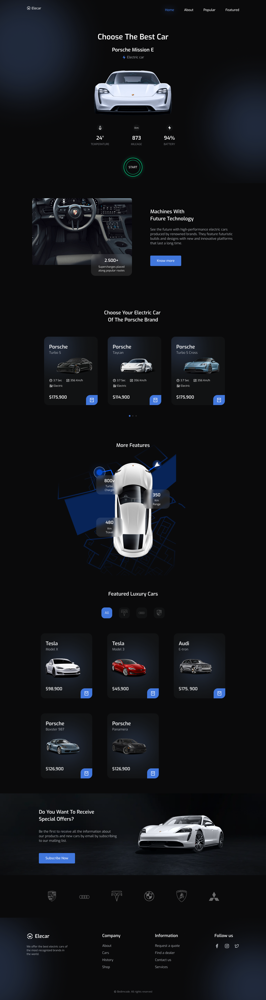
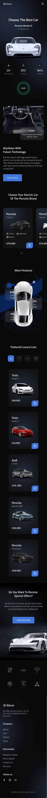

# Car-Shop | Elecar

A responsive electric vehicle landing page inspired by the original Elecar design. This project focuses on code organization, maintainability, and development workflow while preserving the original visual identity.

The codebase uses modular HTML, CSS, and JavaScript, with a structure designed to support future development and a potential migration to React.

## Screenshots

### Desktop Preview



### Mobile Preview



## Design

**Original Figma Design:**
[View the Elecar Design on Figma](https://www.figma.com/design/MXqnlCWUwEngNeBlEXZy7p/Figma-Design-Responsive-car-website--Community-?t=ANHyHu8PXBvGjg6L-0)

## Features

- Responsive layouts for desktop, tablet, and mobile devices
- Interactive mobile navigation menu
- Hero section featuring an electric vehicle and key statistics
- About, Popular, Featured, and Special Offers sections
- Brand showcase and footer
- Locally stored images and SVG icons
- Modular CSS architecture for improved maintainability
- JavaScript ES modules for organizing interactive functionality
- Vite-powered development server and production builds
- Project structure prepared for a potential future React migration

## Technologies

- **HTML5** — Semantic page structure
- **CSS3** — Flexbox, Grid, and responsive layouts
- **JavaScript (ES Modules)** — Interactive functionality and modular code organization
- **Vite** — Development server and production build tooling
- **Swiper** — Slider functionality, if enabled in the current implementation
- **Google Fonts** — Typography
- **Git & GitHub** — Version control and project hosting
- **GitHub Pages** — Project hosting

## Project Structure

```text
Car-shop/
├── assets/
│   ├── Design/
│   ├── img/
│   └── svg/
├── docs/
│   ├── architecture.md
│   └── react-migration-plan.md
├── scripts/
│   ├── modules/
│   │   ├── navigation.js
│   │   └── swiper-bundle.min.js
│   └── main.js
├── styles/
│   ├── base/
│   │   ├── global.css
│   │   ├── reset.css
│   │   ├── typography.css
│   │   └── variables.css
│   ├── components/
│   │   ├── buttons.css
│   │   └── cards.css
│   ├── layout/
│   │   ├── footer.css
│   │   └── header.css
│   ├── sections/
│   │   ├── about.css
│   │   ├── featured.css
│   │   ├── hero.css
│   │   ├── offers.css
│   │   └── popular.css
│   ├── main.css
│   └── responsive.css
├── .gitignore
├── DEMO.md
├── index.html
├── package.json
├── package-lock.json
├── README.md
└── vite.config.mjs
```

> The `dist/` directory is generated during a production build and generally should not be committed to Git.

## Local Development

### Prerequisites

- [Node.js](https://nodejs.org/)
- npm, included with Node.js

### 1. Clone the Repository

```bash
git clone https://github.com/00mohammad/Car-shop.git
```

### 2. Navigate to the Project Directory

```bash
cd Car-shop
```

### 3. Install Dependencies

```bash
npm install
```

### 4. Start the Development Server

```bash
npm run dev
```

Open the local URL displayed in your terminal.

### 5. Build for Production

```bash
npm run build
```

Vite generates the production-ready files in the `dist/` directory.

### 6. Preview the Production Build

```bash
npm run preview
```

Open the preview URL displayed in your terminal.

## Deployment

The project uses Vite and is intended for repository-based GitHub Pages deployment.

For a repository named `Car-shop`, the Vite configuration should use the following base path:

```js
import { defineConfig } from "vite";

export default defineConfig({
  base: "/Car-shop/",
});
```

Building the project locally does not automatically publish it. GitHub Pages must be configured to deploy the production build, usually through a GitHub Actions workflow that publishes the contents of `dist/`.

## Technical Documentation

- [Architecture Documentation](./docs/architecture.md)
- [React Migration Plan](./docs/react-migration-plan.md)
- [Demo and Usage Notes](./DEMO.md)

## Live Demo

[View the Live Demo on GitHub Pages](https://00mohammad.github.io/Car-shop/)

## Future Improvements

- Refine navigation behavior across screen sizes
- Improve accessibility, keyboard navigation, and semantic HTML
- Review image loading and asset optimization
- Expand modular JavaScript functionality where needed
- Test responsive behavior across common viewport sizes
- Prepare reusable UI components for a potential future React migration

## Author

**Mohammad Honarmande**

- GitHub: [@00mohammad](https://github.com/00mohammad)

---

This project is developed for front-end practice, portfolio development, and continuous improvement of modern web development skills.
